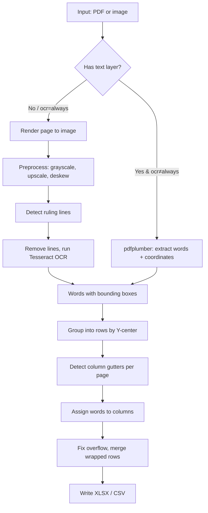

# table2sheet — User Guide

**Fully offline PDF / image table → XLSX / CSV converter.**  
No internet, no cloud API, no account. Everything runs on your machine.

---

## What it does

table2sheet reads tables from PDFs and images and exports them as clean spreadsheets:

- **Text-layer PDFs** (e.g. Excel-printed price lists) — extracts exact text directly, no OCR errors, preserves leading zeros on codes like `010000000`
- **Scanned PDFs, photos, screenshots** — runs local Tesseract OCR (free, offline after install)
- Automatically finds columns per page from white-space gaps or ruling lines
- Handles multi-page documents, shifted layouts between pages, and wrapped description lines
- Keeps text exactly as printed by default (`52,919.00` stays a string unless you ask for numbers)

---

## Quick Start (Zero-Admin / No Installation)

On company-restricted laptops (where running installers, PowerShell shortcut scripts, or `winget` is blocked):

1. **Do not run any installer.**
2. Simply double-click **`run.bat`** (or the shortcut **`Run table2sheet`**).
3. The application opens immediately in your default web browser at `http://localhost:8765` without needing administrator rights.
4. For text-based PDFs (e.g. price lists printed from Excel/Word), **no OCR or external tools are needed**.

---

## Installation (Optional / Manual Setup)

```
pip install -r requirements.txt
```

Requires **Python 3.10+**. Use `install_windows.bat` (Windows) or `install.sh` (Mac/Linux) to do this automatically and create a desktop shortcut.

### Step 2 — Tesseract OCR (only for scanned PDFs / images)

| OS | Command |
|---|---|
| Windows | `winget install UB-Mannheim.TesseractOCR` |
| macOS | `brew install tesseract` |
| Linux | `sudo apt install tesseract-ocr` |

> [!NOTE]
> Text-based PDFs (like Excel-exported price lists) **do not need Tesseract at all**. Install it only if you plan to process scans or photos.

If Tesseract is installed but not on your PATH, tell the app where it is:
```
python table2sheet.py scan.pdf --tesseract-cmd "C:\Program Files\Tesseract-OCR\tesseract.exe"
```
Or set the environment variable `TESSERACT_CMD` to the same path.

---

## Running the app

### GUI (double-click or no arguments)

```
python table2sheet.py
```

The window opens automatically when no files are given. Use it to:
- **Add files** — click "Add files..." to pick PDFs or images (duplicates are ignored)
- **Remove selected** — select a file in the list and click "Remove selected"
- **Clear all** — remove all files from the list
- **Output folder** — pick where to save results (defaults to same folder as each input file)
- **Format** — choose `xlsx`, `csv`, or `both`
- **OCR** — `auto` (use OCR only when no text layer), `always`, or `never`
- **Numbers as numbers** — convert price-like cells to real numbers in the spreadsheet
- **Merge into one file** — combine all inputs into a single output table
- **★ CPT Mode (Clean Rates & Deduplicate)** — keep Code, Description, Department, and all room rates (Suite, Ward, Private, OPD), excluding extraneous metadata, and automatically remove duplicates
- **OPD rates only** — in CPT mode, keep only OPD/outpatient rates (OP, OP (With Contrast), OP (Package)) and hide ward, room, and inpatient columns
- **Precise (slow)** — OCR each cell individually in bordered scans (most accurate)
- **OCR lang** — Tesseract language code (default `eng`; for Filipino: `fil`; multiple: `eng+fil`)
- **Pages** — which PDF pages to process, e.g. `1-3,7` (blank = all pages)
- **Force Columns** — force a specific column count if auto-detection gets it wrong
- **CPT Rate Col** — isolate a single Rate column in CPT mode (leave blank to keep all rates)
- **Excel Sheet** — specific sheet name when input is an Excel workbook (auto-detected by default)

Click **▶ Convert** to run. Progress and any warnings appear in the log area.

---

### Command line

```
python table2sheet.py [files or folders] [options]
```

#### Common examples

```bash
# Convert one PDF to XLSX (saved next to the PDF)
python table2sheet.py price_list.pdf

# Convert to both XLSX and CSV, save in a folder
python table2sheet.py price_list.pdf -f both -o out/

# Convert a scanned image to CSV
python table2sheet.py scan.png -f csv

# Merge multiple page images into one spreadsheet
python table2sheet.py page1.png page2.png page3.png --merge -o combined.xlsx

# Process a whole folder of scans
python table2sheet.py scans_folder/ --merge -o combined.xlsx

# Philippine price list (Tagalog OCR + codes kept as text)
python table2sheet.py list.pdf --lang eng+fil --text-cols 0,1

# Force 5 columns (auto-detection wrong)
python table2sheet.py awkward.pdf --ncols 5

# Only pages 1-3 and page 7 of a PDF
python table2sheet.py catalog.pdf --pages 1-3,7

# Convert numbers, keep code column as text
python table2sheet.py prices.pdf --numbers --text-cols 0

# Bordered scanned table, cell-by-cell OCR (most accurate, slow)
python table2sheet.py bordered_scan.png --precise

# CPT Preprocessing: extract 4 columns (Code, Description, Department, Rate) and remove duplicates
python table2sheet.py hospital_cpt.xlsx --cpt --numbers -o clean_cpt.xlsx

# CPT mode with custom rate column (e.g. WARD) and specific Excel sheet
python table2sheet.py hospital_master.xlsx --cpt --rate-col WARD --sheet "Sheet1" -o ward_cpt.xlsx
```

#### All options

| Option | Default | Meaning |
|--------|---------|---------|
| `-f xlsx\|csv\|both` | `xlsx` | Output format |
| `-o PATH` | next to input | Output folder (or file name with `--merge` or single input) |
| `--cpt` | off | CPT mode: Code, Description, Department + all room rates (Suite, Ward, OPD, etc.) + deduplication |
| `--opd-only` | off | CPT mode: keep only OPD/OP rates (hide ward, room, and inpatient columns) |
| `--rate-col NAME` | all rates | Isolate a single Rate column in CPT mode (default: keeps all room rates) |
| `--sheet NAME` | auto | Sheet name when input is an Excel workbook |
| `--merge` | off | Combine all inputs into one table |
| `--ocr auto\|always\|never` | `auto` | `auto` = OCR only pages with no text layer |
| `--precise` | off | Bordered scans: OCR every cell separately (slower, most accurate) |
| `--lang CODE` | `eng` | Tesseract language(s), e.g. `eng+fil` |
| `--dpi N` | `300` | Render resolution for PDF-to-image before OCR |
| `--min-conf N` | `30.0` | Drop OCR words below this confidence (0–100) |
| `--pages SPEC` | all | PDF pages to process, e.g. `1-3,7` |
| `--ncols N` | auto | Force exact number of columns |
| `--columns "A,B,C"` | from PDF | Override header names |
| `--no-header` | off | Table has no header row |
| `--numbers` | off | Convert numeric-looking cells to real numbers |
| `--text-cols 0,2` | `0` | Columns always kept as text (0-based index) |
| `--gutter N` | `0.5` | Min column gap, as multiple of median text height |
| `--merge-wrapped` | off | Glue wrapped description lines onto the row above |
| `--key-col N` | `0` | Column that must be non-empty to start a new row (with `--merge-wrapped`) |
| `--keep-preamble` | off | Keep title/subtitle lines above the table |
| `--compare ref.csv` | — | Diff the result against a reference CSV (QA use) |
| `--tesseract-cmd PATH` | auto | Path to `tesseract.exe` if not on PATH |
| `--gui` | — | Force the GUI even when files are passed |

---

## Accuracy and tips

### Text-layer PDFs
Accuracy is **exact** — text is read directly from the PDF, not OCR'd.  
Still spot-check a few rows, especially for merged cells or unusual layouts.

### Scanned PDFs and images
| Mode | Typical accuracy |
|------|-----------------|
| Auto (whole-page OCR) | ~75–85% of rows exactly right |
| `--precise` (cell-by-cell) | ~96% of rows exactly right |

**Best practices for good OCR results:**
- Scan at **300 dpi or higher**
- Keep pages straight (the app deskews up to ±4°)
- High contrast — dark ink on white paper
- Avoid shadows, coffee stains, creased pages
- Use `--precise` for bordered (grid-line) tables

> [!WARNING]
> Always review OCR output before using codes or prices for any mapping or calculation. OCR can silently transpose digits (`8` → `3`, `0` → `O`).

### Leading zeros and codes
By default, column 0 is kept as text so codes like `010000000` are not stripped.  
Use `--text-cols 0,1,2` to extend this to more columns.

### Numbers vs text
By default all cells are stored as text strings (safe for codes, reference numbers).  
Add `--numbers` to convert price-like cells to real Excel numbers so you can sum/filter them.

---

## Multi-language OCR

Install the language data files, then pass the language code:

```bash
# Filipino
winget install UB-Mannheim.TesseractOCR   # includes Filipino (fil) data
python table2sheet.py doc.pdf --lang fil

# Mixed English + Filipino
python table2sheet.py doc.pdf --lang eng+fil
```

Available language codes: `eng` (English), `fil` (Filipino/Tagalog), `spa` (Spanish), `chi_sim` (Simplified Chinese), etc.  
See the full list at [tesseract-ocr/tessdata](https://github.com/tesseract-ocr/tessdata).

---

## Sharing between computers (Google Drive)

### Option A — Portable app (recommended, no Python needed on other PCs)

1. On **one Windows PC** with Python installed, double-click `build_windows.bat`
   - Needs internet **this one time only** (downloads PyInstaller + packages)
   - Install Tesseract first if you want OCR support bundled in
2. It creates `table2sheet_portable.zip` with Tesseract included
3. Upload `table2sheet_portable.zip` to Google Drive
4. On any other Windows laptop: download → unzip → double-click `table2sheet.exe`

> [!IMPORTANT]
> The portable `.exe` opens the GUI by default. For command-line use on those laptops, use Option B.

### Option B — Share folder, install per PC

1. Share the `table2sheet_app` folder via Google Drive
2. On each laptop: run `install_windows.bat` (Windows) or `./install.sh` (Mac/Linux)
   - Needs Python 3.10+ and internet only during this install step
   - Creates a desktop shortcut automatically

---

## Troubleshooting

| Problem | Fix |
|---------|-----|
| `Tesseract OCR engine not found` | Install Tesseract (see Installation above) or set `--tesseract-cmd` |
| `No table structure detected` on a page | Try `--ncols N` to force column count, or `--gutter 0.3` to reduce gap threshold |
| Columns merged or split wrong | Try `--ncols N` or `--precise` (for bordered scans) |
| Wrapped descriptions split across rows | Add `--merge-wrapped` |
| Title/header rows included as data | Remove `--keep-preamble` (it's off by default) |
| Repeated header rows in output | Expected — the app deduplicates headers that look the same across pages |
| Leading zeros stripped in Excel | Don't double-click the CSV; open it via **Data → From Text/CSV** in Excel and set that column to "Text" |
| `No input files found` error | Check that the file path exists and the extension is `.pdf`, `.png`, `.jpg`, `.tif`, `.bmp`, or `.webp` |
| OCR text garbled for non-English | Add `--lang fil` (or your language code) |

---

## How it works (overview)



- **Column detection** finds vertical white-space bands between columns, per page. Pages with ambiguous layouts borrow a proven layout from another page in the same run.
- **Bordered tables** (scanned grid-line tables) use detected ruling lines as column separators and optionally OCR each cell individually with `--precise`.
- **Header deduplication** automatically drops repeated header rows when combining multi-page documents.

---

*Generated for table2sheet — offline PDF/image table extractor*
